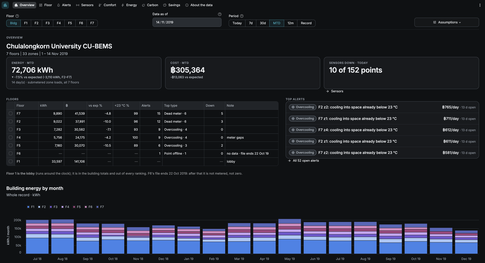

# IS4001 G1 — Smart Building Analytics (CU-BEMS)

Final project for IS4001, using the CU-BEMS Smart Building Energy & Indoor Environmental Data dataset (7 floors, Jul 2018–Dec 2019, 1-minute sampling — AC power, lighting, plug loads, temperature, humidity, ambient light).

Kaggle source: https://www.kaggle.com/datasets/claytonmiller/cubems-smart-building-energy-and-iaq-data/data

**Goal:** understand energy consumption across the building and give facilities managers recommendations they can act on, each with an energy range, a confidence level and a way to verify it.



*The Streamlit dashboard's Overview page. Page-by-page guide and more screenshots: [dashboard/README.md](dashboard/README.md).*

---

## Getting set up

### 1. Install VS Code (if you don't have it)

Download from [code.visualstudio.com](https://code.visualstudio.com) and add the **Python** and **Jupyter** extensions.

### 2. Clone the repo

```bash
git clone https://github.com/<org-or-user>/is4001-g1-smart-building.git
cd is4001-g1-smart-building
```

### 3. Set up your Python environment

```bash
python -m venv .venv
source .venv/bin/activate          # Windows: .venv\Scripts\activate
pip install -r requirements.txt
pip install -e .                   # makes the shared `sbanalytics` package importable
```

In VS Code, pick the `.venv` interpreter as the notebook kernel (top-right of a notebook).

### 4. Build the cleaned data (once, ~2 minutes)

```bash
python -m sbanalytics.pipeline
```

The hourly and daily cleaned files are committed, so the notebooks also run without step 4. Only the minute-level files (`data/cleaned/minute/`, used for drill-downs and by the dashboard) need it.

---

## Repo structure

```
is4001-g1-smart-building/
├── data/
│   ├── raw/                 CU-BEMS CSVs, untouched (2018FloorN.csv, 2019FloorN.csv)
│   ├── external/            weather (ERA5, UTC), Thai holidays, Chula academic calendar
│   ├── cleaned/             pipeline output — see data/cleaned/README.md
│   ├── visuals/             dashboard screenshots and the CU-BEMS floor-plan figure used in the READMEs
│   └── derived/             tables one analysis notebook hands to the next (KPIs, baselines)
├── src/sbanalytics/         the shared code: one set of rules for everyone
│                            (python -m sbanalytics.pipeline builds data/cleaned/)
├── analysis/                start with 0 (know the data), then 01 → 06 (run in order)
│   ├── 00a_data_quality.ipynb         0  what you can and can't trust: coverage map, outage register, cleaning, meter roles, clocks
│   ├── 00b_building_overview.ipynb    0  where the energy goes and when; overcooling in occupied hours
│   ├── 00c_floor_profiles.ipynb       0  what only each floor shows (one section per floor owner)
│   ├── 01_descriptive_kpis.ipynb      A  how does each floor normally behave?
│   ├── 02_baseline_models.ipynb       B  what should it have used? (ASHRAE G14 baselines)
│   ├── 03_comparison.ipynb            C  who is worse, and when?
│   ├── 04_anomaly_detection.ipynb     D  what needs attention? (fault register)
│   ├── 05_forecasting.ipynb           E  what is coming tomorrow?
│   └── 06_recommendations.ipynb       F  what should facilities management do?
└── dashboard/               Streamlit dashboard: building overview + operations pages for every floor, reads data/cleaned/
                             (design rules, tokens and the Figma link: dashboard/DESIGN.md)
```

### Inside `src/sbanalytics` 

| Module | Purpose |
|---|---|
| `config` | paths and cleaning thresholds (with the reason for each) |
| `registry` | every raw column on every floor: zone, channel, unit, **role** (primary / residual / dead / supply-air sensor / scaled index …), bounds; change-points, measured AC schedules |
| `io` | strict readers for raw CSVs, weather (UTC → local), holidays, calendar |
| `clean` | range → glitch caps → spike rule → ≤ 5-min gap interpolation, with a change log |
| `quality`, `health` | per-point daily health (computed before cleaning) and scoring |
| `resample`, `features` | minute → hourly/daily with coverage flags; calendar, day types, schedules |
| `pipeline` | builds `data/cleaned/` |
| `data` | loaders for the cleaned data (`D.load_hourly(floor=None)` = whole building) |
| `energy`, `comfort`, `faults`, `analysis` | the dashboard's analytics (end use, comfort, FDD rules, thermal model, setpoint savings, pilot power) |
| `kpis`, `baseline`, `anomaly`, `forecast` | the cross-floor analytics used in `analysis/` |
| `viz` | one colour-blind-safe chart style; floor N is always the same colour |

---

## How the data is cleaned 

| Problem | Rule |
|---|---|
| Impossible values | outside per-point bounds in the registry → NaN |
| Logger glitches found by floor owners (F4, F5) | kept as caps → NaN |
| Reconnect bursts (e.g. 4,762 kW on a light meter) | > 3×P99.9, ≤ 3 min, rolling median < cap/3 → NaN |
| Short gaps | interpolate interior gaps ≤ 5 min; **longer gaps are never filled** |
| Stuck sensors | flagged in the health table, not deleted |
| Hour / day usability | hour usable if ≥ 48 min present; day if ≥ 20 usable hours |
| Timestamps | Bangkok local time, no shift; weather converted UTC → local |
| Calendar | holidays from the shared CSV; closures and worked holidays detected from load |

Cleaning changes each floor's energy totals by less than 0.4%. Every changed minute is in `data/cleaned/cleaning_log.csv`.

---

## Floor owners

| Floor | Owner |
|---|---|
| Floor 1 | Leyna |
| Floor 2 | Shree |
| Floor 3 | Mik |
| Floor 4 | Kenneth |
| Floor 5 | Terence |
| Floor 6 | Williams |
| Floor 7 | Sana |
